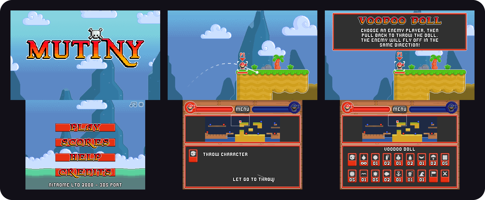
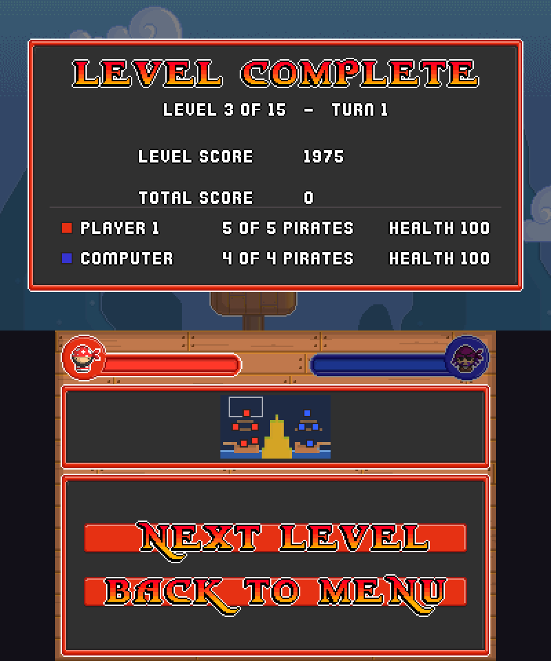
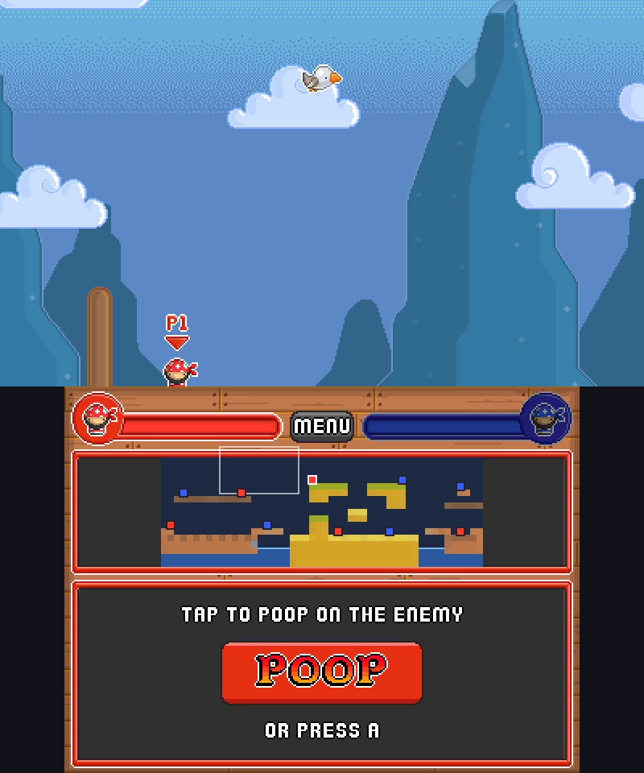

<h1 align="center">Mutiny 3DS</h1>

<p align="center">
  <strong>Pirates, cannons and a very angry seagull.</strong><br>
  Nitrome's turn-based pirate artillery game, rebuilt natively for two Nintendo 3DS screens.
</p>

<p align="center">
  <a href="#download-and-installation">Download</a> ·
  <a href="#features">Features</a> ·
  <a href="#documentation">Documentation</a> ·
  <a href="docs/CONTRIBUTING.md">Contribute</a> ·
  <a href="#credits">Credits</a>
</p>

<p align="center">
  <a href="https://github.com/EstebanPdN/mutiny-3ds/releases/tag/v1.0"></a>
  <a href="#download-and-installation"></a>
  <a href="docs/legal/THIRD-PARTY-LICENSES.md"></a>
</p>

<p align="center">
  
</p>

<p align="center">
  <a href="https://estebanpdn.github.io/"></a>
  <a href="https://discord.gg/BjbzfRYpV"></a>
  <a href="https://www.patreon.com/c/EstebanPdN"></a>
</p>

Native Nintendo 3DS port of [*Mutiny*](https://www.nitrome.com/), the 2008 Flash game by
**Nitrome**. The original ActionScript 2 game logic was rewritten in C, and the Flash
animations play back through a small MovieClip runtime written for this port. The top screen
shows the game. The bottom screen is a new touch interface drawn in pixel art.

This project was developed with the help of [Claude Code](https://claude.com/product/claude-code). Learn more about the development process [here](AI_DEVELOPMENT.md).

*Mutiny* and all of its artwork, animation, music, sound, text and level design are © Nitrome.
This is an unofficial fan port. It is not affiliated with or endorsed by Nitrome.

## Features

<table>
  <tr>
    <td width="50%" valign="top"><strong>Made for two screens</strong><br>The game on top. Team health, a live minimap and the turn's controls on the touch screen below.</td>
    <td width="50%" valign="top"><strong>The whole game</strong><br>All 15 story levels, all 18 two-player battle maps and all 15 weapons, from cherry bombs to the tidal wave.</td>
  </tr>
  <tr>
    <td width="50%" valign="top"><strong>Throw with the stylus</strong><br>Touch, pull back and let go. Slide across pirates and weapons to preview them, and drag the minimap to look around.</td>
    <td width="50%" valign="top"><strong>Faithful to the original</strong><br>Original animations, masks, sounds and music at the game's own 25 frames per second, drawn pixel-perfect.</td>
  </tr>
</table>

<p align="center">
  
  
</p>

### Feature details

* **Story mode** against the computer, with the original dialogue, scores and the end-of-game screen.
* **Two players** on one console, taking turns on 18 battle maps. Treasure chests in two-player
  games hold 1 to 5 different random weapons, with 1 to 10 of each. They never give a weapon that
  is already infinite for that pirate.
* **Bottom-screen interface**: choose a pirate, pick a weapon, aim, place crates, barrels and
  anchors on the minimap, steer the parachute bomb, fire the cannon or send the tidal wave.
* **Test match**: press **START + SELECT** together, in a menu or during a game, to start a
  two-player battle where every pirate carries 5 of every weapon.
* Nitrome's original intro on start-up, a two-screen pause window with match information, and
  local best scores.

## Download and installation

<p>
  <a href="https://github.com/EstebanPdN/mutiny-3ds/releases/download/v1.0/mutiny-3ds-v1.0.cia"></a>
  <a href="https://github.com/EstebanPdN/mutiny-3ds/releases/download/v1.0/mutiny-3ds-v1.0.3dsx"></a>
</p>

**Stable: [v1.0](https://github.com/EstebanPdN/mutiny-3ds/releases/tag/v1.0).** Requires a
Nintendo 3DS family console with custom firmware (Luma3DS).

1. Install the CIA with FBI. Scan the QR code from the
   [release page](https://github.com/EstebanPdN/mutiny-3ds/releases/tag/v1.0) with
   **Remote Install → Scan QR Code**, or copy the file to your SD card.
2. Or copy the 3DSX to `sdmc:/3ds/` and start it from the Homebrew Launcher.
3. Start **Mutiny** from the HOME Menu. Progress and settings are saved to
   `sdmc:/3ds/mutiny/mutiny.sav`.

The application is self-contained: it needs no other files.

### Audio

Audio requires a dumped DSP firmware. If you hear no sound, open the Luma3DS Rosalina menu and use:

```text
Miscellaneous options > Dump DSP firmware
```

## Controls

| Input | Action |
| --- | --- |
| Touch screen | Everything: pirates, weapons, aiming, buttons and the minimap. |
| D-Pad / Circle Pad | Move the camera, or the placement cursor. |
| A | Confirm, or use the current action. |
| B | Back. |
| L / R | Previous / next pirate. |
| Y | Slow placement cursor; switch the cannon between moving and aiming. |
| START | Pause. |
| START + SELECT | Start the all-weapons test match. |

## Documentation

| Guide | Purpose |
| --- | --- |
| [Architecture](docs/ARCHITECTURE.md) | How the port is built: data pipeline, MovieClip runtime, game logic and platforms. |
| [Source map](docs/SOURCE-MAP.md) | What every source file and tool does. |
| [Development](docs/DEVELOPMENT.md) | Extract the game data, build for macOS and 3DS, and run scripted tests. |
| [Contributing](docs/CONTRIBUTING.md) | How to report bugs and propose changes. |
| [Changelog](CHANGELOG.md) | Changes in each release. |

<details>
<summary><strong>Build from source</strong></summary>

You need your own copy of `Mutiny.swf`. The repository contains no Nitrome content: the build
extracts and converts it locally. You also need devkitPro (devkitARM, libctru, citro2d,
citro3d, `bannertool`, `makerom`), Java for JPEXS, Python 3 with Pillow and NumPy, FFmpeg, and
CMake with SDL3 for the macOS build.

```sh
tools/extract.sh path/to/Mutiny.swf
tools/.venv/bin/python -I tools/gen_ui.py build/extract assets/ui
tools/.venv/bin/python -I tools/gen_lines.py build/extract src/game/lines.h
tools/.venv/bin/python -I tools/gen_3ds_meta.py
tools/build_3ds.sh          # build/3ds/mutiny.3dsx and mutiny.cia
```

See the [development guide](docs/DEVELOPMENT.md) for the full setup.

</details>

## Credits

**Mutiny** © 2008 [Nitrome](https://www.nitrome.com/). Credits from the original game:

* **Programming**: Chris Burt-Brown, Heather Stancliffe
* **Artwork**: Jon Annal, Mat Annal
* **Music**: Dave Cowen

Port:

* **Esteban PDN**: Nintendo 3DS and macOS port, two-screen interface and pixel art, release maintenance

Tools and libraries:

* [devkitPro](https://devkitpro.org/): devkitARM, libctru, citro2d and citro3d
* [JPEXS Free Flash Decompiler](https://github.com/jindrapetrik/jpexs-decompiler): SWF extraction (build-time tool only)
* [SDL3](https://www.libsdl.org/): macOS development build
* [zlib](https://zlib.net/): game data compression
* [bannertool](https://github.com/Epicpkmn11/bannertool) and [makerom (Project_CTR)](https://github.com/3DSGuy/Project_CTR): CIA packaging
* [Azahar](https://github.com/azahar-emu/azahar): emulator testing

See [THIRD-PARTY-LICENSES](docs/legal/THIRD-PARTY-LICENSES.md) for licenses and notices.

## License and legal notice

The original port source code is distributed under **GNU GPL v3.0 or later**. See [LICENSE](LICENSE).

The game content belongs to Nitrome and is **not** covered by that license. This repository
contains no Nitrome files: no SWF, extracted graphics, sound or text. The release builds contain
the game data converted from the original SWF, for personal use. If Nitrome asks for any of it to
be removed, it will be removed.
